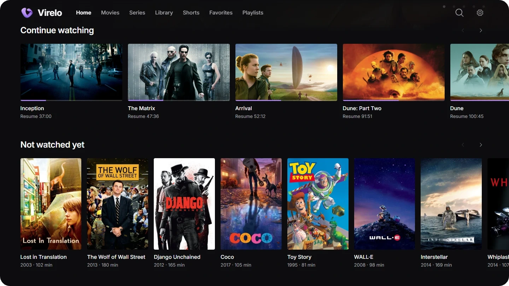
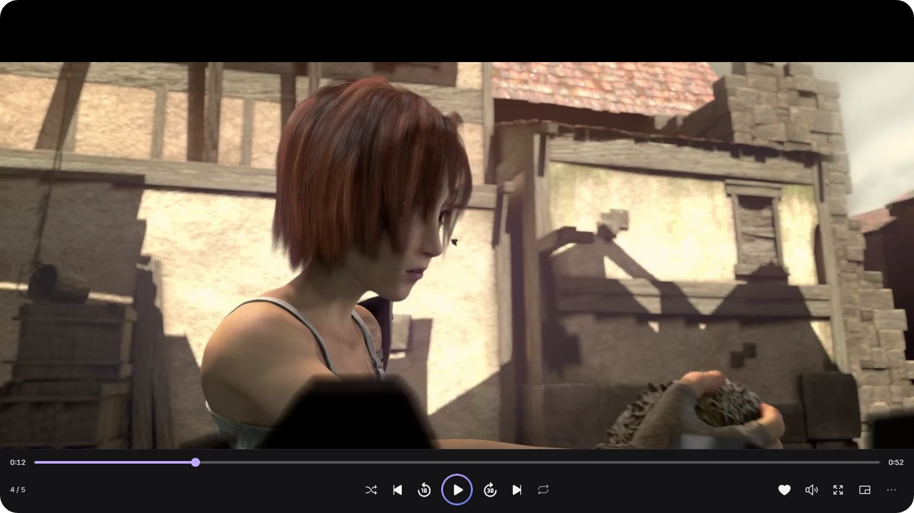

<div align="center">
  
  <h1>Virelo</h1>
  <p><strong>Your folders. A streaming library.</strong></p>
  <p>Browse the videos you already have, in your browser or on your own server.<br />Free and open source. No uploads to Virelo.</p>
  <p>
    <a href="https://www.npmjs.com/package/virelo"></a>
    <a href="LICENSE"></a>
    <a href="https://github.com/VireloHQ/Virelo/actions/workflows/ci.yml"></a>
  </p>
  <p>
    <a href="https://app.virelo.dev/"></a>
    &nbsp;
    <a href="https://virelo.dev/setup"></a>
  </p>
  <p><a href="https://virelo.dev/">Website</a> &nbsp;·&nbsp; <a href="https://virelo.dev/blog">What's new</a> &nbsp;·&nbsp; <a href="https://github.com/VireloHQ/Virelo/issues">Feedback</a></p>
</div>

<a href="https://app.virelo.dev/"></a>

<p align="center">Self-hosted demo library. Videos are not included. <a href="docs/images/readme/README.md">Media credits</a></p>

## Less searching. More watching.

- **Pick up where you left off.** Continue a video, queue or playlist without rebuilding your session.
- **Make it your collection.** Search folders, save favorites, arrange playlists and shuffle the queue.
- **A feed of your own.** Swipe through portrait clips in Shorts, using files already on your device.
- **Playback that fits.** Subtitles, audio tracks, speed controls and optional volume leveling, where supported.
- **Keep watching while you browse.** The in-app miniplayer keeps your video or Shorts playing as you move around Virelo.

Available in English, Japanese, Simplified Chinese, Korean and Russian. [Localization details](docs/LOCALIZATION.md).



<p align="center">Player demo: <a href="https://durian.blender.org/">Sintel</a>, © Blender Foundation · <a href="https://creativecommons.org/licenses/by/3.0/">CC BY 3.0</a></p>

## Two ways to start

| | Browser app | Self-hosted server |
| --- | --- | --- |
| Video files | Folders on this device | Folders on your server |
| Where you watch | This device | Devices on your trusted network |
| Accounts | None | Administrator and user accounts |
| Movie / TV artwork | Locally generated thumbnails | Optional online title and artwork matching |

### In your browser

No installation or account required.

1. Open **[app.virelo.dev](https://app.virelo.dev/)**.
2. Choose your video folder and grant read access.
3. Browse, play, and build your first playlist.

Your files stay on your device. Folder access and supported formats depend on your browser; this mode does not share your folder with other devices.

### On your own server

Open a terminal in your video folder:

```sh
npx virelo --here
```

Create the first administrator account from localhost on the server device. The server adds user accounts, shared libraries, access permissions and optional movie/TV metadata and artwork. Use it on your trusted network, not directly on the public internet.

Already have saved libraries? Run `npx virelo` without `--here`.

[Self-hosting guide](https://virelo.dev/setup) · [Server and CLI reference](apps/server/README.md) · [Browser player docs](apps/web/README.md)

## Help shape Virelo

Something getting in the way of watching your collection? [Report a bug](https://github.com/VireloHQ/Virelo/issues) or [share a feature idea](https://github.com/VireloHQ/Virelo/discussions).

If Virelo is useful to you, [star the repository](https://github.com/VireloHQ/Virelo/stargazers) so you can find it again and help others discover it.

<details>
<summary><strong>Development</strong></summary>

Use Node.js 22.23.4+, 24.22.1+ or 26.12.1+ within those release lines. From the repository root:

```sh
npm ci
npm run check
```

Build either edition with `npm run build -w apps/web` or `npm run build -w apps/server`.

[Workspace structure](docs/workspace.md) · [Contributing](CONTRIBUTING.md) · [Release documentation](docs/releasing.md)

</details>

---

Virelo's player and server are [AGPL-3.0-only](LICENSE). Third-party code and artwork retain their own licenses; see the [screenshot credits](docs/images/readme/README.md). The [official website](https://virelo.dev/) is maintained separately. Browser and self-hosted editions have independent storage, permissions and release schedules.
